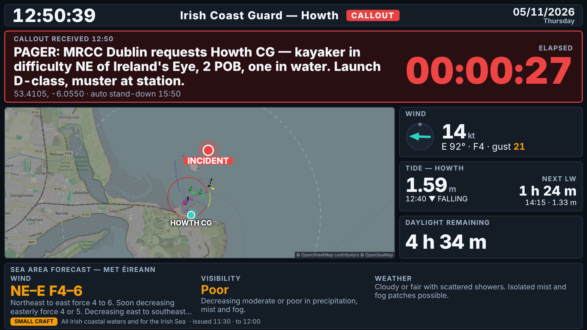

# Howth Coast Guard — Ops Wall Display (Phase 1)

Full-screen wall dashboard for the Irish Coast Guard station at Howth, Co. Dublin
(53.388 N, 6.065 W). Runs on a TV in a browser kiosk, read from ~4 m, no touch.
Phase 1 uses public data only; Phases 2 (WhatsApp crew muster) and 3 (D4H
availability) plug into the interfaces described at the bottom.

| Standby | Callout |
| --- | --- |
|  |  |

Both screenshots are real data, rendered at 1920×1080 by `scripts/screenshot.mjs`.

## What is on screen

**Standby**: clock, date, station, active Met Éireann warnings banner (marine + Dublin
land warnings) · wind (forecast now + Dublin Airport observation), est. visibility,
precipitation, air temp, QNH · next 6 h strip · map with station, 5/10 km rings, AIS dots ·
tide (gauge level, trend, surge, next HW/LW countdown, ±6 h curve, springs/neaps) ·
sea state (SWAN model point off Howth + M2 buoy observation) · daylight remaining,
sunrise/sunset/civil dusk, moon · crew muster placeholder · AIS count · webcam ·
feed health dots.

**Callout**: incident block (pager text verbatim, time received, big red elapsed timer,
position) · map at ~70 % width with incident pin, station and rings · wind, tide,
daylight only · crew muster panel. Everything else hidden.

## Data sources — verification results (24/10/2026)

Each endpoint was exercised live before code was written against it.

| # | Source | Status | Notes |
| --- | --- | --- | --- |
| 1 | Met Éireann location forecast (`openaccess.pf.api.met.ie/metno-wdb2ts/locationforecast`) | ✅ works | Harmonie hourly XML. The HTTPS URL 301s to an Azure Container Apps host whose TLS handshake failed from the build sandbox; plain HTTP worked. Provider tries HTTPS then HTTP. **No visibility element exists in this feed** — the dashboard shows an *estimated* band (symbol + humidity/dew-point), clearly badged `est.`. |
| 1 | Met Éireann observations (`prodapi.metweb.ie/observations/dublin/today`) | ✅ works | Dublin Airport hourly obs: wind, gust, temp, pressure. Used as the "observed" line under the forecast wind. Undocumented endpoint; may change. |
| 1 | Met Éireann warnings | ✅ works | `met.ie/warningsxml/rss.xml` → CAP 1.2 files on `cap.met.ie`. This feed includes **marine** warnings (Gale, Small Craft) that the county JSON feed omits. Locality: land warnings matched on EMMA code EI07 (Dublin); marine warnings matched by walking the "from A to B to C" headland arc against *Howth Head* (`server/src/util/seaAreas.ts`). The old `Open_Data/xml` files (`xIrishCoastalReports.xml`, `xSeaCrossing.xml`) are **404 — gone**. |
| 2 | Tide gauge — ERDDAP `IrishNationalTideGaugeNetwork` | ✅ works | Station is `Howth Water Level 1` (there is no "Howth Harbour" id). 5-min data, LAT and OD Malin. |
| 2 | Tide predictions — ERDDAP `IMI_TidePrediction_HighLow` + `imiTidePrediction` | ✅ works | Station `Howth`. HW/LW list is OD Malin only; the 5-min curve carries both datums so the OD Malin→LAT offset (2.56 m at Howth) is learned from it and applied. Displayed heights are above Chart Datum like the tide tables. |
| 2 | Dublin Bay buoy | ❌ not on ERDDAP | No Dublin Bay wave buoy dataset exists on erddap.marine.ie (searched "dublin", "buoy", "wave", listed all wave-network stations). **Substituted** with the Marine Institute Irish Shelf SWAN wave model sampled at 53.40 N 5.95 W, labelled "SWAN model" on screen. If a Dublin Port Company feed turns up, add a provider writing `sea.local`. |
| 2 | M2 weather buoy — ERDDAP `IWBNetwork` | ✅ works | Hourly; wind already in knots, Hs in m, sea temp. |
| 3 | Sun/moon | ✅ local | `suncalc`. |
| 4 | AIS — aisstream.io | ✅ works (key required) | Verified live with a free key: WebSocket stream bounded to Dublin Bay/Howth, vessels appear within a minute (ferries, ILV Granuaile, naval). Set `AISSTREAM_API_KEY`; without it the panel is a placeholder. |
| 5 | Howth Harbour webcam | ❌ stubbed | No stable, embeddable still-image URL found (only aggregator pages on windy/yr, and Afloat's Sandycove stream which looks *at* Howth from across the bay). Set `WEBCAM_IMAGE_URL` to any JPEG/PNG still and the panel works. |
| 6 | Map tiles | ✅ works | OSM standard tiles (dimmed) + OpenSeaMap seamarks. CARTO dark tiles now require an API key and were dropped. One kiosk is within the OSM tile usage policy; for a fleet, self-host tiles. |

## Quick start

```bash
cp .env.example .env            # set CALLOUT_TOKEN (and AISSTREAM_API_KEY if you have one)
docker compose up -d --build
# open http://<host>:8080
```

Local development (Node 20+):

```bash
npm install
npm run dev          # server on :8080 (tsx watch) + Vite on :5173 proxied to it
npm test             # provider parser tests (vitest, fixture payloads)
npm run typecheck
npm run build && npm start
CALLOUT_TOKEN=... npm run screenshots   # needs playwright + chromium installed
```

Multi-arch image (Pi 5 is arm64, NUC is amd64):

```bash
docker buildx build --platform linux/amd64,linux/arm64 -t ghcr.io/<you>/howth-cg-dashboard:latest --push .
```

> The Docker daemon was not available in the environment this was built in, so the
> image build was **not** exercised there; the compiled server (`npm run build && node
> server/dist/server/src/index.js`) was. CI (`.github/workflows/ci.yml`) builds the
> multi-arch image on every push.

## Configuration

Everything lives in `config.yaml` (mounted read-only into the container). Any key can be
overridden from the environment:

* Named shortcuts: `PORT`, `HOST`, `DATA_DIR`, `CALLOUT_TOKEN`, `CALLOUT_AUTO_STANDDOWN_MINUTES`,
  `AISSTREAM_API_KEY`, `WEBCAM_IMAGE_URL`, `STATION_NAME`, `STATION_LAT`, `STATION_LON`, `MAP_TILE_URL`.
* Generic: `CFG__<path>__<to>__<key>=value`, e.g. `CFG__providers__ais__enabled=false`,
  `CFG__panels__webcam=false`, `CFG__providers__metWarnings__localRegionCodes=EI07,EI18`.

Key sections: `station` (coords, name), `callout` (token, auto stand-down minutes),
`panels` (on/off per panel), `map` (tile URLs, zooms, ring radii, base brightness),
`providers.*` (`enabled`, `pollIntervalMs`, endpoint/station ids, thresholds).

## HTTP API

| Method | Path | Auth | Purpose |
| --- | --- | --- | --- |
| GET | `/api/state` | – | Full `DashboardState` (what the screen renders) |
| GET | `/api/mode` | – | Current mode + incident |
| WS | `/api/ws` | – | Pushes `{type:'state', state}` on connect and on every change (≤4/s), `ping` every 20 s |
| GET | `/healthz` | – | `ok` / `degraded` / `down` (503) with per-provider status |
| POST | `/api/callout` | Bearer | Body `{ "text": "...", "lat"?: n, "lon"?: n, "receivedAt"?: iso, "source"?: "whatsapp" }` → callout mode |
| POST | `/api/standdown` | Bearer | Back to standby |
| POST | `/api/refresh?provider=name` | Bearer | Force a poll (debugging) |

Auth is `Authorization: Bearer <CALLOUT_TOKEN>` (or `X-Api-Token`). With no token configured
the mutating endpoints return 503 rather than being open.

```bash
curl -X POST http://localhost:8080/api/callout -H "Authorization: Bearer $CALLOUT_TOKEN" \
  -H 'content-type: application/json' \
  -d '{"text":"PAGER: kayaker in difficulty NE of Ireland'"'"'s Eye","lat":53.41,"lon":-6.055}'
curl -X POST http://localhost:8080/api/standdown -H "Authorization: Bearer $CALLOUT_TOKEN"
```

Mode is persisted to `data/mode.json`, so a container restart mid-incident comes back in
callout mode with the timer still running; auto stand-down fires at
`callout.autoStanddownMinutes` (default 180).

## Architecture

```
server/src
  index.ts          bootstrap: config → store → scheduler → fastify
  config.ts         config.yaml + env overrides
  state.ts          StateStore: owns DashboardState, emits 'change'
  derive.ts         cross-provider derivations (surge = gauge − predicted)
  scheduler.ts      one poll loop per provider, exponential back-off, stale detection
  callout.ts        standby/callout state machine, auto stand-down, persistence
  http.ts           REST + WebSocket + static frontend
  providers/        one module per source (see "Adding a provider")
  util/             erddap, xml, http, units, seaAreas
shared/types.ts     DashboardState — shared by server and web
web/src             vanilla TS + Vite; main.ts renders state into panels, map.ts = MapLibre
```

Failure isolation: a provider that throws keeps its last-good slice on screen, its health
goes `error`→`stale` once the data is older than `staleAfterMs` (default 2.5× poll), the
panel shows **STALE since HH:MM**, and that provider alone backs off (×2 per failure, cap
30 min). The screen is never blanked by a dead feed.

Kiosk resilience: WebSocket auto-reconnect with back-off, heartbeat watchdog, full page
reload after 5 min without a server, daily reload at 04:00, reload on server version
change. Server uses bounded data structures only (AIS table expires vessels; CAP cache is
pruned to the current feed).

## Adding a provider

1. Create `server/src/providers/<name>.ts` exporting a factory that returns a `Provider`:

   ```ts
   export function fooProvider(cfg: AppConfig): Provider {
     const c = cfg.providers.foo;
     return {
       name: 'foo',
       pollIntervalMs: c.pollIntervalMs,
       enabled: c.enabled,
       kind: 'poll',                 // 'stream' (implement start/stop) or 'stub'
       staleAfterMs: 2 * 3600_000,   // optional
       async fetch(ctx) {            // return a slice of DashboardData; throw on failure
         const rows = await fetchErddap(tabledapUrl(c.erddap, c.dataset, [...], [...]));
         return { sea: { ...ctx.current().sea, local: parseFoo(rows) } };
       },
     };
   }
   ```
   Keep the parsing in a pure `parseFoo(payload)` so it can be unit-tested against a fixture.
2. Add its config block to `config.yaml` and the `AppConfig` type in `config.ts`.
3. If it introduces new data, extend `shared/types.ts` and render it in `web/src/panels/`.
4. Register it in `server/src/providers/index.ts`.
5. Drop a captured payload in `server/test/fixtures/` and add a `*.test.ts`.

## Running the kiosk on a Raspberry Pi 5

1. Raspberry Pi OS (64-bit, desktop). Install Docker (`curl -fsSL https://get.docker.com | sh`),
   clone this repo, `docker compose up -d`.
2. Chromium kiosk: either the systemd user unit `kiosk/howth-cg-kiosk.service`
   (`cp` to `~/.config/systemd/user/`, `systemctl --user enable --now howth-cg-kiosk`,
   `loginctl enable-linger $USER`) or the desktop autostart file
   `kiosk/autostart-kiosk.desktop` (`cp` to `~/.config/autostart/`). Both wait for
   `/healthz` before launching `chromium-browser --kiosk ... --app=http://localhost:8080/`.
3. Screen blanking off: run `kiosk/disable-screen-blanking.sh` once (handles X11 `xset`
   and Wayfire `[idle]`), and set the TV itself to never sleep / disable HDMI-CEC standby.
   `sudo apt install unclutter` hides the cursor (the page also sets `cursor: none`).
4. Set the display to 1920×1080 (`raspi-config` → Display, or `wlr-randr`). The layout is
   fixed at that resolution; a 4K TV should be driven at 1080p.
5. Optional: `sudo raspi-config` → Boot → Desktop autologin, and a read-only root
   overlay once stable. Logs: `docker compose logs -f`.

## Phase 2 / Phase 3 hooks

Phase 1 was built so the next phases are additive — no rewrite.

**Callout trigger (Phase 2, WhatsApp).** A bridge process (or a Fastify plugin inside this
server) receives the pager/WhatsApp message and calls `POST /api/callout` with the message
text verbatim, optional lat/lon (parse from the message or a geocode), `receivedAt` and
`source: "whatsapp"`. `POST /api/standdown` on the "stand down" message. The in-process
API is `CalloutManager.callout({text, lat, lon, receivedAt, source})` / `.standdown()` in
`server/src/callout.ts`. The token is already required; use a long random
`CALLOUT_TOKEN` and keep the bridge on the station LAN.

**Crew muster (Phase 2 WhatsApp replies / Phase 3 D4H).** The display already renders the
`muster` slice (`shared/types.ts`):

```ts
interface MusterState {
  responders: Responder[];                // id, name, status, etaMin?, roles[], updatedAt, source
  roles: Record<string, string[]>;        // role name → responder ids covering it
  minimumCrew: number;                    // from config.providers.muster.minimumCrew
  requiredRoles: string[];                // from config, e.g. OIC, Boat Cox, Crew, Crew, Driver
  source: 'stub' | 'whatsapp' | 'd4h' | 'mixed';
}
```

`Responder.status` ∈ `responding | available | unavailable | on-scene | unknown`. The
panel counts `responding + on-scene` against `minimumCrew` (green when met, amber when
short), shows each required role as filled/open, and in callout mode lists responders with
ETA. To light it up, replace the stub in `server/src/providers/muster.ts` with a provider
that produces this shape — e.g. a `whatsappMuster` provider fed by the same bridge
(replies like "Y 10" → responding, ETA 10 min) and a `d4hAvailability` provider polling the
D4H API for who is on-call. Two providers can both write `muster` by merging via
`ctx.current().muster` (set `source: 'mixed'`). No frontend change is needed.

## Conventions

Metric, knots for wind and vessel speed, metres for waves and tide (above Chart Datum),
24 h clock and DD/MM/YYYY in Europe/Dublin; all timestamps in `DashboardState` are UTC ISO
and formatted client-side.
