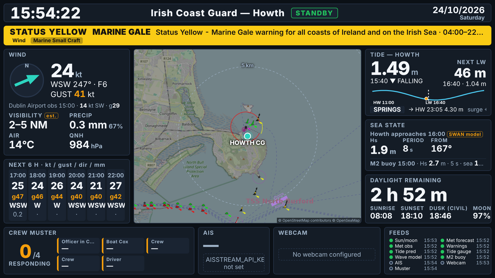
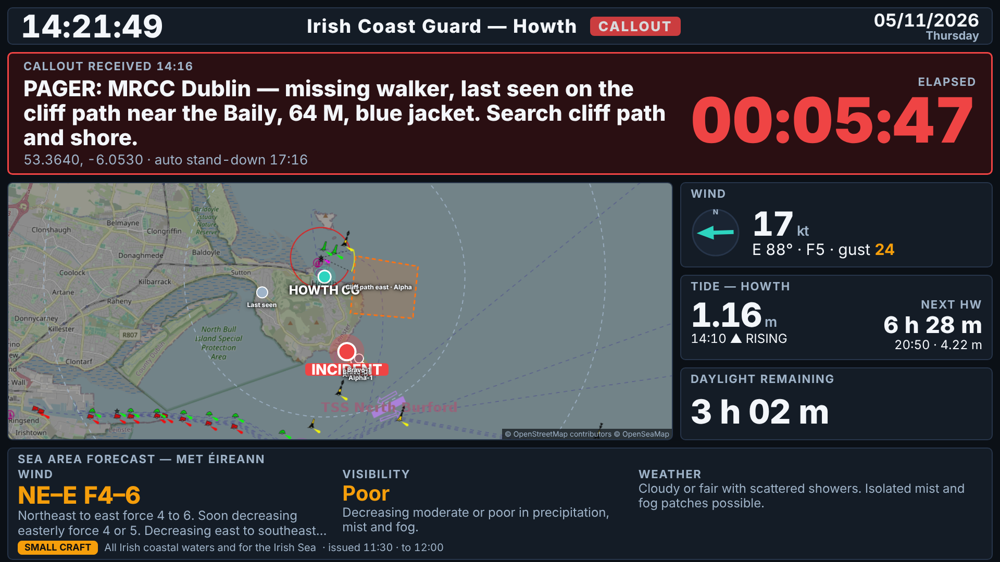
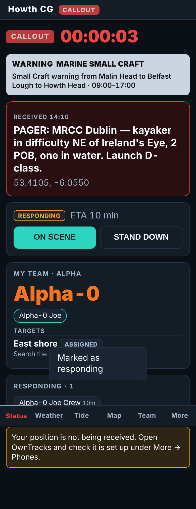
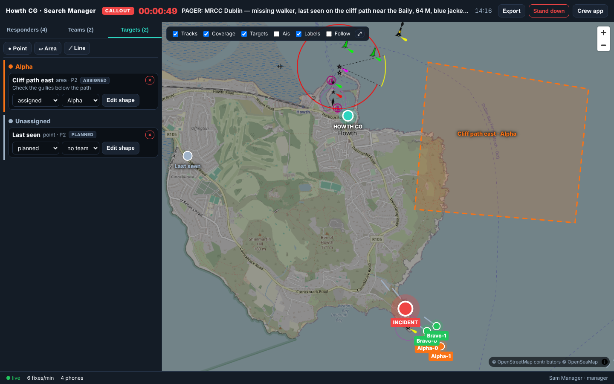

# Howth Coast Guard — Ops Display, Crew App and Search Manager

Full-screen wall dashboard for the Irish Coast Guard station at Howth, Co. Dublin
(53.388 N, 6.065 W), plus (Phase 2) a hosted server with crew accounts, a mobile crew app,
OwnTracks position tracking and a search-management console.

| Standby (TV) | Callout with search teams (TV) |
| --- | --- |
|  |  |

| Crew app | Search manager console |
| --- | --- |
|  |  |

All screenshots are real data, rendered by Playwright (`scripts/screenshot.mjs`).

## Phase 2 in one paragraph

The same server now runs on a Vultr VPS behind Caddy (`docker-compose.yml`) with accounts
(admin / search manager / member), a crew PWA at `/m/`, a laptop console at `/sm/` (with
**Settings** for all administration: users, display keys, backups, retention, audit log,
system status, your account and phones), an
OwnTracks ingest at `/ot`, and a SQLite database (`node:sqlite`, no native modules). Crew press
*I'm responding*; their phones stream positions via OwnTracks; the search manager builds teams
(Alpha-0, Alpha-1, …), draws point/area/line targets, and sees live positions, tracks and a
covered-area overlay. The station Pi mirrors the hosted server for the TV and falls back to
its own feeds if the internet drops. Docs: [RUNBOOK](docs/RUNBOOK.md),
[OWNTRACKS](docs/OWNTRACKS.md), [PRIVACY](docs/PRIVACY.md).

## What is on screen

**Standby**: clock, date, station, active Met Éireann warnings banner (marine + Dublin
land warnings) · wind (forecast now + Dublin Airport observation), est. visibility,
precipitation, air temp, QNH · next 6 h strip · map with station, 5/10 km rings, AIS dots ·
tide (gauge level, trend, surge, next HW/LW countdown, ±6 h curve, springs/neaps) ·
sea state (SWAN model point off Howth + M2 buoy observation) · daylight remaining,
sunrise/sunset/civil dusk, moon · crew muster placeholder · AIS count · webcam ·
feed health dots.

**Callout**: incident block (pager text verbatim, time received, big red elapsed timer,
position) · map at ~70 % width with incident pin, station and rings · wind, tide,
daylight only · crew muster panel. Everything else hidden.

**Tasking**: a search opened from the console without a callout (training, a Garda request,
a planned search). The TV keeps the standby layout with a TASKING tag and shows teams,
targets and the planning point on its map; nobody is paged.

## Data sources — verification results (24/10/2026)

Each endpoint was exercised live before code was written against it.

| # | Source | Status | Notes |
| --- | --- | --- | --- |
| 1 | Met Éireann location forecast (`openaccess.pf.api.met.ie/metno-wdb2ts/locationforecast`) | ✅ works | Harmonie hourly XML. The HTTPS URL 301s to an Azure Container Apps host whose TLS handshake failed from the build sandbox; plain HTTP worked. Provider tries HTTPS then HTTP. **No visibility element exists in this feed** — the dashboard shows an *estimated* band (symbol + humidity/dew-point), clearly badged `est.`. |
| 1 | Met Éireann observations (`prodapi.metweb.ie/observations/dublin/today`) | ✅ works | Dublin Airport hourly obs: wind, gust, temp, pressure. Used as the "observed" line under the forecast wind. Undocumented endpoint; may change. |
| 1 | Met Éireann warnings | ✅ works | `met.ie/warningsxml/rss.xml` → CAP 1.2 files on `cap.met.ie`. This feed includes **marine** warnings (Gale, Small Craft) that the county JSON feed omits. Locality: land warnings matched on EMMA code EI07 (Dublin); marine warnings matched by walking the "from A to B to C" headland arc against *Howth Head* (`server/src/util/seaAreas.ts`). The old `Open_Data/xml` files (`xIrishCoastalReports.xml`, `xSeaCrossing.xml`) are **404 — gone**. |
| 2 | Tide gauge — ERDDAP `IrishNationalTideGaugeNetwork` | ✅ works | Station is `Howth Water Level 1` (there is no "Howth Harbour" id). 5-min data, LAT and OD Malin. |
| 2 | Tide predictions — ERDDAP `IMI_TidePrediction_HighLow` + `imiTidePrediction` | ✅ works | Station `Howth`. HW/LW list is OD Malin only; the 5-min curve carries both datums so the OD Malin→LAT offset (2.56 m at Howth) is learned from it and applied. Displayed heights are above Chart Datum like the tide tables. |
| 2 | Dublin Bay buoy | ✅ works (via dublinbaybuoy.com) | Not on ERDDAP, but [dublinbaybuoy.com](https://dublinbaybuoy.com/) republishes the Irish Lights MetOcean telemetry from the Dublin Bay safe water mark (53.332 N, 6.077 W) as a PostgREST API: hourly Hs, period, water temp, wind/gust in knots, gale flag. Publishable key in `config.yaml` / `DUBLINBAY_API_KEY`. *Data from Dublin Bay Buoy, sourced from Irish Lights MetOcean — not for navigation.* The Marine Institute SWAN model point off Howth remains as a fallback (`sea.model`). |
| 2 | M2 weather buoy — ERDDAP `IWBNetwork` | ✅ works | Hourly; wind already in knots, Hs in m, sea temp. |
| 3 | Sun/moon | ✅ local | `suncalc`. |
| 4 | AIS — aisstream.io | ✅ works (key required) | Verified live with a free key: WebSocket stream bounded to Dublin Bay/Howth, vessels appear within a minute (ferries, ILV Granuaile, naval). Set `AISSTREAM_API_KEY`; without it the panel is a placeholder. |
| 5 | Howth Harbour webcam | ❌ stubbed | No stable, embeddable still-image URL found (only aggregator pages on windy/yr, and Afloat's Sandycove stream which looks *at* Howth from across the bay). Set `WEBCAM_IMAGE_URL` to any JPEG/PNG still and the panel works. |
| 6 | Map tiles | ✅ works | OSM standard tiles (dimmed) + OpenSeaMap seamarks. CARTO dark tiles now require an API key and were dropped. One kiosk is within the OSM tile usage policy; for a fleet, self-host tiles. |

## Quick start

```bash
cp .env.example .env            # set CALLOUT_TOKEN (and AISSTREAM_API_KEY if you have one)
docker compose up -d --build
# open http://<host>:8080
```

Local development (Node 20+):

```bash
npm install
npm run dev          # server on :8080 (tsx watch) + Vite on :5173 proxied to it
npm test             # provider parser tests (vitest, fixture payloads)
npm run typecheck
npm run build && npm start
CALLOUT_TOKEN=... npm run screenshots   # needs playwright + chromium installed
```

Multi-arch image (Pi 5 is arm64, NUC is amd64):

```bash
docker buildx build --platform linux/amd64,linux/arm64 -t ghcr.io/<you>/howth-cg-dashboard:latest --push .
```

> The Docker daemon was not available in the environment this was built in, so the
> image build was **not** exercised there; the compiled server (`npm run build && node
> server/dist/server/src/index.js`) was. CI (`.github/workflows/ci.yml`) builds the
> multi-arch image on every push.

## Configuration

Everything lives in `config.yaml` (mounted read-only into the container). Any key can be
overridden from the environment:

* Named shortcuts: `PORT`, `HOST`, `DATA_DIR`, `CALLOUT_TOKEN`, `CALLOUT_AUTO_STANDDOWN_MINUTES`,
  `AISSTREAM_API_KEY`, `WEBCAM_IMAGE_URL`, `STATION_NAME`, `STATION_LAT`, `STATION_LON`, `MAP_TILE_URL`.
* Generic: `CFG__<path>__<to>__<key>=value`, e.g. `CFG__providers__ais__enabled=false`,
  `CFG__panels__webcam=false`, `CFG__providers__metWarnings__localRegionCodes=EI07,EI18`.
* From the console: `/sm/` → Settings → **Data feeds** edits the AIS key, Dublin Bay buoy
  key, webcam URL and label at runtime (stored in SQLite, feed restarted immediately). A
  value set there overrides the env var and `config.yaml`; clearing it falls back.

Key sections: `station` (coords, name), `callout` (token, auto stand-down minutes),
`panels` (on/off per panel), `map` (tile URLs, zooms, ring radii, base brightness),
`providers.*` (`enabled`, `pollIntervalMs`, endpoint/station ids, thresholds).

## HTTP API

| Method | Path | Auth | Purpose |
| --- | --- | --- | --- |
| GET | `/api/state` | – | Full `DashboardState` (what the screen renders) |
| GET | `/api/mode` | – | Current mode + incident |
| WS | `/api/ws` | – | Pushes `{type:'state', state}` on connect and on every change (≤4/s), `ping` every 20 s |
| GET | `/healthz` | – | `ok` / `degraded` / `down` (503) with per-provider status |
| POST | `/api/callout` | Bearer | Body `{ "text": "...", "lat"?: n, "lon"?: n, "receivedAt"?: iso, "source"?: "whatsapp" }` → callout mode |
| POST | `/api/standdown` | Bearer | Back to standby |
| POST | `/api/refresh?provider=name` | Bearer | Force a poll (debugging) |

Auth is `Authorization: Bearer <CALLOUT_TOKEN>` (or `X-Api-Token`), or a signed-in manager's
session. With no token configured and accounts off, the mutating endpoints return 503.

**Phase 2 routes** (accounts on, `AUTH_OPEN=false`): `POST /api/auth/login|logout|password|privacy-accept|display`,
`GET /api/incidents` (history), `GET /api/incidents/:id/replay`, `GET /api/incidents/:id/report[.html]` (manager);
`GET /api/auth/me`; `GET|POST|PATCH|DELETE /api/users…` (admin); `GET|POST|DELETE /api/admin/display-keys`,
`GET /api/admin/audit`, `GET /api/admin/backups`, `POST /api/admin/backup|retention`;
`GET|POST|DELETE /api/devices…`, `POST /api/devices/link` (one-tap setup for this phone), `GET /api/devices/:id/link|qr.svg|config.otrc`; `POST /ot` (OwnTracks, Basic auth);
`GET /api/search`; `POST /api/incidents`, `POST /api/incidents/:id/close`, `GET /api/incidents/:id/tracks|export.geojson`,
`PUT /api/incidents/:id/response`; `POST /api/incidents/:id/teams`, `PATCH|DELETE /api/teams/:id`,
`PUT /api/teams/:id/members`; `POST /api/incidents/:id/targets`, `PATCH|DELETE /api/targets/:id`;
`GET|POST /api/incidents/:id/points`, `PATCH|DELETE /api/points/:id` (typed planning points); `GET /api/incidents/:id/search-area` (terrain-shaped regions, member);
`GET /api/admin/terrain`, `POST /api/admin/terrain/build` (admin);
`GET|PUT /api/incidents/:id/subject` (+`/photo`; the subject's `category` is a MISPER-UK slug and `terrain` a MISPER-UK terrain name, both validated; `suicideThreatened`, `depression`, `significantPlaceKnown` feed the plan card);
`GET /api/positions/latest`. WebSocket `/api/ws` carries `state`, `search`, `pos`, `auth`, `ping`.

```bash
curl -X POST http://localhost:8080/api/callout -H "Authorization: Bearer $CALLOUT_TOKEN" \
  -H 'content-type: application/json' \
  -d '{"text":"PAGER: kayaker in difficulty NE of Ireland'"'"'s Eye","lat":53.41,"lon":-6.055}'
curl -X POST http://localhost:8080/api/standdown -H "Authorization: Bearer $CALLOUT_TOKEN"
```

Mode is persisted to `data/mode.json`, so a container restart mid-incident comes back in
callout mode with the timer still running; auto stand-down fires at
`callout.autoStanddownMinutes` (default 180).

## Architecture

```
server/src
  index.ts          bootstrap: config → store → scheduler → fastify
  config.ts         config.yaml + env overrides
  state.ts          StateStore: owns DashboardState, emits 'change'
  derive.ts         cross-provider derivations (surge = gauge − predicted)
  scheduler.ts      one poll loop per provider, exponential back-off, stale detection
  callout.ts        standby/callout state machine, auto stand-down, persistence
  http.ts           REST + WebSocket + static frontend
  providers/        one module per source (see "Adding a provider")
  util/             erddap, xml, http, units, seaAreas
shared/types.ts     DashboardState, SearchSnapshot, Fix… — shared by server and web
shared/lpb          lost person behaviour: MISPER-UK dataset (generated), types, helpers (rings, shares)
server/src/terrain  terrain grid build (Copernicus, LiDAR, OSM), ITM projection, cost-distance, contours
web/src             vanilla TS + Vite; main.ts = TV, m/ = crew PWA, sm/ = console, map.ts = MapLibre
server/src/db       node:sqlite wrapper + numbered migrations
server/src/auth     scrypt passwords, sessions + display keys, role middleware, routes
server/src/search   devices (OwnTracks creds), tracking, owntracks ingest, service (incidents/
                    responses/teams/targets), routes, tracks (GeoJSON), geometry, retention
server/src/ws.ts    Hub: per-socket principal, state/search/pos broadcast
server/src/upstream.ts  Pi mirror of the hosted server with local fallback
```

Failure isolation: a provider that throws keeps its last-good slice on screen, its health
goes `error`→`stale` once the data is older than `staleAfterMs` (default 2.5× poll), the
panel shows **STALE since HH:MM**, and that provider alone backs off (×2 per failure, cap
30 min). The screen is never blanked by a dead feed.

Kiosk resilience: WebSocket auto-reconnect with back-off, heartbeat watchdog, full page
reload after 5 min without a server, daily reload at 04:00, reload on server version
change. Server uses bounded data structures only (AIS table expires vessels; CAP cache is
pruned to the current feed).

## Adding a provider

1. Create `server/src/providers/<name>.ts` exporting a factory that returns a `Provider`:

   ```ts
   export function fooProvider(cfg: AppConfig): Provider {
     const c = cfg.providers.foo;
     return {
       name: 'foo',
       pollIntervalMs: c.pollIntervalMs,
       enabled: c.enabled,
       kind: 'poll',                 // 'stream' (implement start/stop) or 'stub'
       staleAfterMs: 2 * 3600_000,   // optional
       async fetch(ctx) {            // return a slice of DashboardData; throw on failure
         const rows = await fetchErddap(tabledapUrl(c.erddap, c.dataset, [...], [...]));
         return { sea: { ...ctx.current().sea, local: parseFoo(rows) } };
       },
     };
   }
   ```
   Keep the parsing in a pure `parseFoo(payload)` so it can be unit-tested against a fixture.
2. Add its config block to `config.yaml` and the `AppConfig` type in `config.ts`.
3. If it introduces new data, extend `shared/types.ts` and render it in `web/src/panels/`.
4. Register it in `server/src/providers/index.ts`.
5. Drop a captured payload in `server/test/fixtures/` and add a `*.test.ts`.

## SD card image (flash and boot)

`image/build-image.sh` turns stock Raspberry Pi OS Lite (arm64) into an appliance image:
Node 20, Chromium in a Wayland kiosk (`cage`), the dashboard as two systemd services,
1080p forced on HDMI, console blanking off, SSH on, hostname `howth-cg`. No Docker.
It needs root, loop devices and `qemu-user-static`, so it runs in GitHub Actions:

1. Actions → **pi-image** → *Run workflow* (or push a tag `v0.1.0`, which also attaches
   the image to a release). ~30–40 min. Download `howth-cg-dashboard-pi.img.xz`.
2. Flash with Raspberry Pi Imager (*Use custom*). With Ethernet nothing else is needed.
3. On the card's `bootfs` partition edit `howth-cg.env` (callout token, AIS key, webcam
   URL). Optionally drop a `howth-cg.yaml` there to replace the baked-in `config.yaml`.
   For Wi-Fi, rename `howth-cg-wifi.conf.example` → `howth-cg-wifi.conf` and fill in
   `SSID=`/`PSK=` (plus optional `SSID2=`/`PSK2=`). A first-boot service feeds it to
   NetworkManager and renames it `.applied`. Already booted? `sudo nmcli dev wifi
   connect "SSID" password "PSK"` on the console (Ctrl+Alt+F2) does the same.
4. Boot. First boot expands the filesystem (~1 min); the display comes up by itself.

Default login `cg` / `howthcg` over SSH — change it (`passwd`) or set your own in Imager.
Admin: `sudo journalctl -u howth-cg-dashboard -f`, `sudo systemctl restart howth-cg-kiosk`,
`curl localhost:8080/healthz`. Layout of what the script installs is in `image/rootfs/`.

Tested on: the image build in CI only so far — see the workflow run for the SHA256.
First boot on real Pi 5 hardware still needs a check (cage/Chromium on the Pi 5 KMS
driver is the usual thing to verify).

## Running the kiosk on a Raspberry Pi 5

1. Raspberry Pi OS (64-bit, desktop). Install Docker (`curl -fsSL https://get.docker.com | sh`),
   clone this repo, `docker compose up -d`.
2. Chromium kiosk: either the systemd user unit `kiosk/howth-cg-kiosk.service`
   (`cp` to `~/.config/systemd/user/`, `systemctl --user enable --now howth-cg-kiosk`,
   `loginctl enable-linger $USER`) or the desktop autostart file
   `kiosk/autostart-kiosk.desktop` (`cp` to `~/.config/autostart/`). Both wait for
   `/healthz` before launching `chromium-browser --kiosk ... --app=http://localhost:8080/`.
3. Screen blanking off: run `kiosk/disable-screen-blanking.sh` once (handles X11 `xset`
   and Wayfire `[idle]`), and set the TV itself to never sleep / disable HDMI-CEC standby.
   `sudo apt install unclutter` hides the cursor (the page also sets `cursor: none`).
4. Any resolution works: the layout is designed on a 1920×1080 grid and scales to the screen
   (4K, 720p, ultra-wide). 1080p is still the sensible choice on a Pi for GPU headroom.
5. Optional: `sudo raspi-config` → Boot → Desktop autologin, and a read-only root
   overlay once stable. Logs: `docker compose logs -f`.

## Phase 2 status and Phase 3 hooks

Implemented: hosted server, accounts, crew PWA, OwnTracks tracking, teams/targets/coverage
console, TV integration, Pi mirror, backups, retention, audit.

Still external: the **pager/WhatsApp bridge** that turns a page into `POST /api/callout`
(bridge token) and the **push notification** to crew phones on callout (Web Push; needs VAPID
keys and a push subscription table). Both slot in without schema changes beyond a
`push_subscriptions` table. D4H availability could feed `responses` with status `available`.

Further candidates, including a lost-person-behaviour search planning module, are in
[docs/BACKLOG.md](docs/BACKLOG.md).

## Lost person behaviour data (MISPER-UK)

`shared/lpb/misperUk.ts` holds the UK missing-person statistics shown on the console's
*Behaviour* tab and drawn as distance rings: 15 subject categories, 5,406 incidents, from
[MISPER-UK](https://misper.uk/) by The Centre for Search Research (Mountain Rescue England
and Wales data; UK Missing Person Behaviour Study 2011, Perkins, Roberts & Feeney). It is
generated, not hand-typed:

```bash
node scripts/fetch-misper.mjs     # rewrites shared/lpb/misperUk.ts from the live site
npm test                          # server/test/lpb.test.ts reconciles every category
```

The site publishes cumulative deciles (10–100 %). The plan card draws rings at 25, 50, 75
and 90 % (`PLAN_RING_PCTS` in `shared/lpb/plan.ts`); 25 and 75 are interpolated between
the deciles and marked as such, 95 % is never derived from deciles (the 90–100 % gap is
tens or hundreds of km) and the 100 % value is never drawn. Rings at 0 km are skipped and
the card warns when a large share of a category is recorded at the planning point.

Two further sources, both transcribed by hand with checks in `server/test/lpb2011.test.ts`:

- `shared/lpb/ukmpbs2011.ts`: the UK Missing Person Behaviour Study, August 2011
  (Perkins, Roberts & Feeney; n=1271). It splits distance, outcome and location by terrain
  and sex, gives the location detail level (road vs path, habitation vs shelter), the
  despondent characteristic modifiers (Table 16 and section c) and each category's
  "possible scenarios". Every table is cited by number on the card; a few printed figures
  that do not add up are kept as printed and listed in the test.
- `shared/lpb/isridAsd.ts`: Koester (2020), Journal of Search & Rescue 4(1), the one
  open-access ISRID paper: autism spectrum disorder (children and adults) and typically
  developing children, by ecoregion (Ireland = temperate), with 25/50/75/95 % distance,
  track offset, mobility, find location, outcome and survival-over-days. The rest of ISRID
  (Koester, *Lost Person Behavior*, 2008) is not reproduced: it is not openly licensed.

`shared/lpb/plan.ts` `buildPlan()` picks the most specific 2011 segment for the subject
(category + terrain + sex → category + terrain → category + sex → category) and reports
the level and n it used; `shared/lpb/tactics.ts` holds the reflex tasks with the statistic
behind each one. These are UK and international land-search figures: use them with the
tide, drift and local knowledge panels, not instead of them, and only as a trained search
manager (misper.uk's own condition of use). misper.uk and the 2011 study state no reuse
licence; the data is used here with attribution for operational planning, and permission
from The Centre for Search Research (tcsr.org.uk) should be confirmed before wider
distribution.

## Placing points and positions

The console's map has one box, **Search a place or paste a position**. The New tasking dialog has the same box. It reads:

| Input | Example |
| --- | --- |
| Decimal degrees, any order or hemisphere letters | `53.3905, -6.068`, `53.3905N 6.068W` |
| Degrees and decimal minutes, as given at sea | `53 23.43N 006 04.08W` |
| Degrees, minutes, seconds | `53°23'25.8"N 6°04'04.8"W` |
| ITM (EPSG:2157) | `ITM 728900 739100`, or any pair with a northing over 500 000 |
| Irish Grid, from OSi maps | `O 287 385`, `O2870038500`, or a numeric pair under 500 000 |
| A place name | `Baily Lighthouse`, `Summit car park`, `Thormanby Road` |

Place names come from the OpenStreetMap data the terrain build already reads. The build writes about 23,000 named places, roads and paths to `data/terrain/places.json`, so search needs no internet at callout time. A terrain built before this version has no place index: rebuild it once in Settings → Terrain. Irish Grid references convert to WGS84 within 3 m of PROJ. Eircodes are not supported, because looking one up needs a licensed service.

Choosing a result, or clicking the map after a **+ point** button, opens a small label box on the map with the kind, a label and a note. Enter saves. A position given when a tasking opens becomes its last known position.

## Terrain-shaped search areas

The rings are straight-line statistics. On the console map each one is also drawn as the
ground that distance can actually reach from the planning point: a cost-distance region over
a 10 m grid (`server/src/terrain/`). Walking effort per metre is 1 on flat open ground, more
on slopes (Tobler's hiking function, clamped so it never drops below 1) and on rough cover
(heath 1.3, woodland 1.5, scrub 1.8, rock 2, wetland 3). Sea, inland water, mapped cliffs,
slopes over 35°, rivers, railways and motorways are walls except where a road, path or pier
crosses them. Because no factor is below 1, every region sits inside its circle: the
terrain only takes reach away. Movement uses 16 directions with no corner cutting, so a
one-cell wall is watertight and open ground comes out at about 97 % of the circle. Rings out
to about 6 km are modelled at 10 m; longer ones share a coarser window.

Inside the outer area each cell gets a probability of area (POA): the category's share at
the point itself goes to the first 60 m, each band between rings gets its share, and within a
band cells are weighted by where this category is found (MISPER-UK locations: travel aid,
trees, water's edge, habitation, linear feature, open ground) against how much of each the
band holds, capped at ×5 / ×0.2. Least-cost routes to marked significant places are weighted
×2, the place itself ×3 ("lines and points"). The console shows it as a heat overlay and up
to 12 ranked square segments clipped to the ground (200 m, 400 m or 800 m depending on the
search size); **Target** turns a segment into an area target with its POA in the notes.

The grid is built once per station from open data and kept under `data/terrain/` (about
60 MB, plus a ~380 MB OpenStreetMap extract in the download cache if Overpass was not
available; not in git):

```bash
npm run terrain:build                       # or Settings → Terrain → Build (admin)
npm run terrain:build -- --refresh-osm      # refetch OpenStreetMap
node server/dist/server/src/terrain/cli.js  # inside the production image
```

| Layer | Source | Licence |
| --- | --- | --- |
| Heights, everywhere | Copernicus DEM GLO-30, read by HTTP range from AWS open data | Copernicus free licence, attribution |
| Heights, coast and road corridors | GSI / OPW (NASC) and TII 2 m LiDAR DTM tiles | CC BY 4.0 |
| Coast, cliffs, water, roads and paths, rail, land use | OpenStreetMap via Overpass (several mirrors, oversize boxes split automatically), else the Ireland PBF extract (`osmExtractUrl`) | ODbL |

`config.yaml → terrain` sets the box (default Dublin city centre to Skerries), the cell size
and the Overpass mirrors; defaults apply when the section is absent. `osmSource: extract`
skips Overpass altogether. In the default `auto`, the build switches to the extract once
failed Overpass requests add up to `overpassBudgetS` (300 s), so busy public servers cost
minutes, not hours. Limits shown on the
card: Copernicus is a 30 m surface model (it includes buildings and trees, so slopes are
capped in towns and on roads, and small cliffs can be missed where no LiDAR exists or no
cliff is mapped); tidal flats inside the coastline count as sea; no drift modelling. The
GSI ImageServers only serve hillshade pictures, so the LiDAR comes from the coverage layers'
tile downloads. Tailte Éireann's 5 m DTM is not open; the raster loader would take it if
licensed.

## Conventions

Metric, knots for wind and vessel speed, metres for waves and tide (above Chart Datum),
24 h clock and DD/MM/YYYY in Europe/Dublin; all timestamps in `DashboardState` are UTC ISO
and formatted client-side.
